# cinelog

cinelog records every interactive zsh session exactly once, as an
[asciicast v3](https://docs.asciinema.org/manual/asciicast/v3/) file. Each command gets an
exact marker with the typed text, its expansion, the working directory and the exit status.
A built-in HTTPS server indexes the recordings and lets you search commands and their output
in milliseconds. It also replays any session at the moment a hit happened, watches running
shells live, and draws a timeline of everything that ran.

It is one static binary (`cinelog`) and a thin [zim](https://github.com/zimfw/zimfw) module
(`cinelog.plugin.zsh`). It does not need asciinema, Python or a separate viewer.

<picture>
  <source media="(prefers-color-scheme: dark)" srcset="docs/screenshots/search-dark.png">
  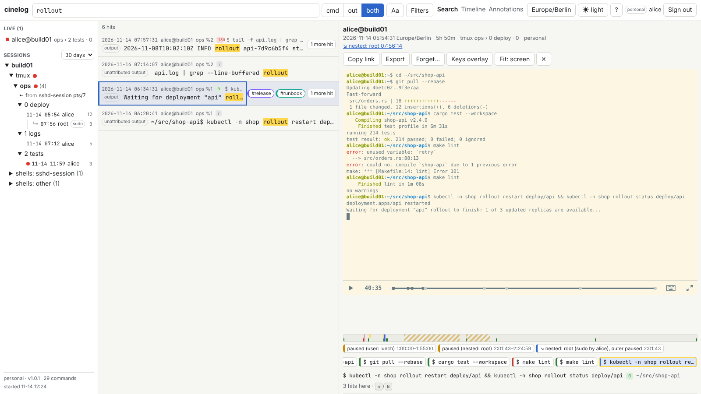
</picture>

## Features

- **Exactly one recording per shell.** Each tmux, screen or zellij pane, each ssh login and
  each terminal tab gets its own cast. cinelog decides who owns the terminal from the PTY
  itself, never from inherited environment variables. While a multiplexer client runs, the
  outer recording pauses, so nothing is recorded twice.
- **Exact command boundaries.** Commands are marked in-band with a per-recording nonce. The
  recorder strips and timestamps these markers, so a command can only land in the cast of
  the shell that ran it ([PROTOCOL.md](docs/PROTOCOL.md)).
- **Fast search** over commands and their rendered output (SQLite FTS5 trigram), including
  sessions that are still running. Use `cinelog search` with fzf in the terminal, or the
  search page in the browser.
- **Web UI:** search with a split player and chapters per command, a timeline across panes
  and users, live view, annotations and tags, and `.cast`/`.txt`/`.html` export. It runs on
  your LAN over TLS, with a one-time token and an HttpOnly cookie.
- **Team recording for root shells.** `sudo -i`, `sudo -s`, `su` and root logins are
  recorded below `/root/logs/<member>/`. A system unit serves them, and each member has
  their own token.
- **Never in the way.** If recording cannot start, the shell starts unrecorded with a
  single warning. Non-interactive shells (`zsh -i -c`, VS Code environment probes) are never
  recorded.
- **Old recordings stay readable.** Casts from the old plugin are imported read-only, with
  their command boundaries reconstructed from the old banners.

## Contents

- [Install](#install)
- [Team (root) recording](#team-root-recording)
- [Daily use](#daily-use)
- [Web UI](#web-ui)
- [Configuration](#configuration)
- [Upgrading and uninstalling](#upgrading-and-uninstalling)
- [Building from source](#building-from-source)
- [Behaviour notes](#behaviour-notes)
- [Documentation](#documentation)

## Install

Requirements: Linux on x86_64 or aarch64, zsh with [zim](https://github.com/zimfw/zimfw),
and `curl` or `wget`. Optional: `fzf` for interactive search, and systemd for the
server unit. Without systemd, recorded shells start the server themselves.

1. Add the module to `~/.zimrc`, together with the download hook:

   ```zsh
   zmodule cmprmsd/cinelog --on-pull 'zsh shell/fetch.zsh'
   ```

2. Run `zimfw install`. `shell/fetch.zsh` downloads the release binary for your
   architecture to `<module>/bin/cinelog` and checks it against the checksum committed in
   this repository (`shell/checksums/v<VERSION>.sha256`). Only then does it replace the
   previous binary. Without network access it builds the binary with
   `cargo build --release --locked` instead.

3. Recommended, for the fastest start: make this the **first** line of `~/.zshrc`, above any
   instant prompt:

   ```zsh
   [[ -r ${ZIM_HOME:-~/.zim}/modules/cinelog/shell/early.zsh ]] && source ${ZIM_HOME:-~/.zim}/modules/cinelog/shell/early.zsh
   ```

   Without this line the module still works, but the start costs one extra partial
   `.zshrc` run.

4. Run `~/.zim/modules/cinelog/bin/cinelog install` once. It:
   - creates the directories with private modes;
   - writes a commented `~/.config/cinelog/config.toml`;
   - links `~/.local/bin/cinelog`;
   - installs and starts the user unit `cinelog.service`;
   - prints the web login token **once**.

   The server creates its certificate on its first start. Then `cinelog tls show` (or
   `cinelog doctor`) prints the fingerprint to compare on the login page.

   If you used the old plugin, see [docs/MIGRATING.md](docs/MIGRATING.md) first.

5. Open a new terminal. The first line of the MOTD shows the session and its cast file.
   `cinelog doctor` checks the whole setup.

`zimfw update` keeps the module and the binary in step. After a new binary has been
verified, `install --refresh` points the symlink at it and restarts your server.

**Checksum trust.** The checksum file is the trust anchor, and it has the same trust as the
plugin code you already run. The release workflow commits it to `main` after the tag, so:

- A module that tracks `main` (the default) verifies against the committed file.
- A module pinned with `--tag`, or to a commit, never gets that commit. The release's own
  `SHA256SUMS` comes from the same server as the binary, so `fetch.zsh` does not trust it on
  its own and builds the pinned source with cargo instead. To use the release binary, copy
  `shell/checksums/v<VERSION>.sha256` from `main` into the checkout, or run
  `cinelog-fetch --trust-release-sums`.

See [shell/checksums/README.md](shell/checksums/README.md).

**As root**, `fetch.zsh` follows stricter rules:

- It trusts only root-owned paths that are not group- or world-writable.
- It ignores `PATH`, `TMPDIR` and `CINELOG_FETCH_BASE_URL` from the environment.
- It never builds with cargo.
- Shells only fetch a missing binary in the background for non-root users.

Root normally gets its binary from `install --team` (below).

## Team (root) recording

```zsh
sudo ~/.zim/modules/cinelog/bin/cinelog install --team --system-zshrc
```

This installs:

- a root-owned copy of the binary (`/usr/local/bin/cinelog`) and of the plugin;
- a guarded block in `/etc/zsh/zshrc`;
- the hardened system unit `cinelog-team.service` (team web server on port 10000);
- the first named token, for you.

From then on, root shells (`sudo -s`, `sudo -i`, `su`, root logins on the console or over
ssh) are recorded below `/root/logs/<member>/`, without a zim setup for root. Bash root
shells are not covered.

- Always call the module's binary by its full path under sudo. sudo's `secure_path` makes a
  bare `cinelog` the installed team binary, which may be older.
- Add members with `sudo cinelog token new <name>` and remove them with
  `sudo cinelog token revoke <name>`. Revoking also ends that member's web sessions.
- Each member runs the `cinelog token team-login --url … --fingerprint …` line that `install`
  prints once. After that, `cinelog search --team` searches the team history from their own
  shell.
- Give the team server a host name of its own (`server.hostnames` in
  `/etc/cinelog/team.toml`). Browsers share cookies across ports, and a separate name keeps
  the team cookie away from personal servers on the same host
  ([SECURITY.md](docs/SECURITY.md)).

Team recording is a convenience, not an audit control. `cinelog pause`, the kill switch
`/etc/cinelog/disable`, `record.nested = "ignore"` and commands that start with a space all
stay allowed. Every pause or skip leaves a visible mark in the timeline.

## Daily use

| Command | What it does |
|---|---|
| `cinelog search [-a] [TERM]` | Searches commands (and with `-a` also their output) in fzf. The preview shows the command and its output. Enter prints the web link, and opens it on a local desktop. `--print` and `--json` skip fzf |
| `cinelog search --cwd . TERM` | Only commands run in this directory. Also takes `--user`, `--host`, `--since 2d`, `--until`, `--exit fail`, `--pane %3` |
| `cinelog search --team TERM` | Searches the team server's history over HTTPS (after `cinelog token team-login`) |
| `cinelog show <id>` | Prints one command with its output (`<uuid>:<seq>`), or a whole session |
| `cinelog link [--json]` | Prints the session uuid, cast path and web URL of the current shell |
| `cinelog pause [--reason TEXT]`, `cinelog resume` | Pauses and resumes the recording, leaving a visible pause marker. `resume` also continues a recording that stopped on a full disk |
| `cinelog forget <uuid>[:<seq>]` | Removes a session or command from the index, and masks it in playback and export. The cast on disk is not changed |
| `cinelog status`, `cinelog import --report` | Indexer state; per-file results of the legacy import (numbers only) |
| `cinelog index --once \| --rebuild` | Indexes once, or rebuilds the index from the casts. Annotations live in `meta.db` and are kept |
| `cinelog token new\|list\|revoke`, `cinelog tls show\|regen` | Web login tokens; the certificate's fingerprint, names and expiry |
| `cinelog meta export\|import FILE` | Annotations, tags and the forget list as JSON Lines. A copy is also written every night |
| `cinelog compress --now\|--dry-run` | Compresses finished casts older than `retention.compress_after_days` with zstd. Reads stay transparent, and legacy casts are never compressed |
| `cinelog archive-legacy --to DIR [--dry-run]` | Writes zstd copies of the old plugin's casts to `DIR`, keeping their layout. The originals are not changed; delete them yourself once you have checked the copies |
| `cinelog doctor [--json]` | Checks the binary, plugin, units, server, certificate, DB location, terminal detection and version skew |

In a recorded shell:

- **MOTD and banners.** The MOTD starts with `cinelog: session <id> → <cast>`. Every command
  gets right-aligned `Begin [...]` / `End   [...]` banners. Both can be switched off in
  `[shell]`. `cs` clears the screen and prints the MOTD again.
- **Unrecorded commands.** A command that starts with a space gets no command entry. Its
  output is still recorded, and the timeline shows an "unrecorded command" mark.
- **Keystrokes** are recorded, except:
  - at password-like prompts: echo off in canonical mode, or a prompt ending in a colon
    after `password`, `passphrase`, `passcode`, `PIN` or `token` (also `Passwort`,
    `Kennwort`);
  - while the recording is paused.
- **Switching recording off.** `touch ~/.config/cinelog/disable` stops recording new shells.
  Root uses `/etc/cinelog/disable`.

Casts are written to `~/logs/<YYYY-MM>/<host>_<time>_<id>.cast` with mode 0600. Team casts go
to `/root/logs/<member>/<YYYY-MM>/`.

## Web UI

`cinelog link` prints the URL of the current session. The personal server listens on
`https://<host>:<10000+uid>/` and the team server on port 10000. Sign in with the token that
`install` printed, or create a new one with `cinelog token new`. Before you type the token,
compare the fingerprint on the login page with the one `cinelog tls show` prints on the
server's host (for the team server, `install --team` printed it too).

| | Light | Dark |
|---|---|---|
| Search: hits in commands and output, the session at the hit, chapters per command | [](docs/screenshots/search-light.png) | [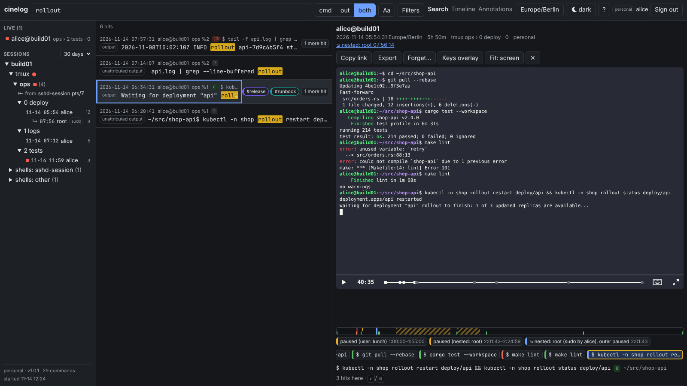](docs/screenshots/search-dark.png) |
| Session: pause and nested-session bands, the command strip, annotations with tags | [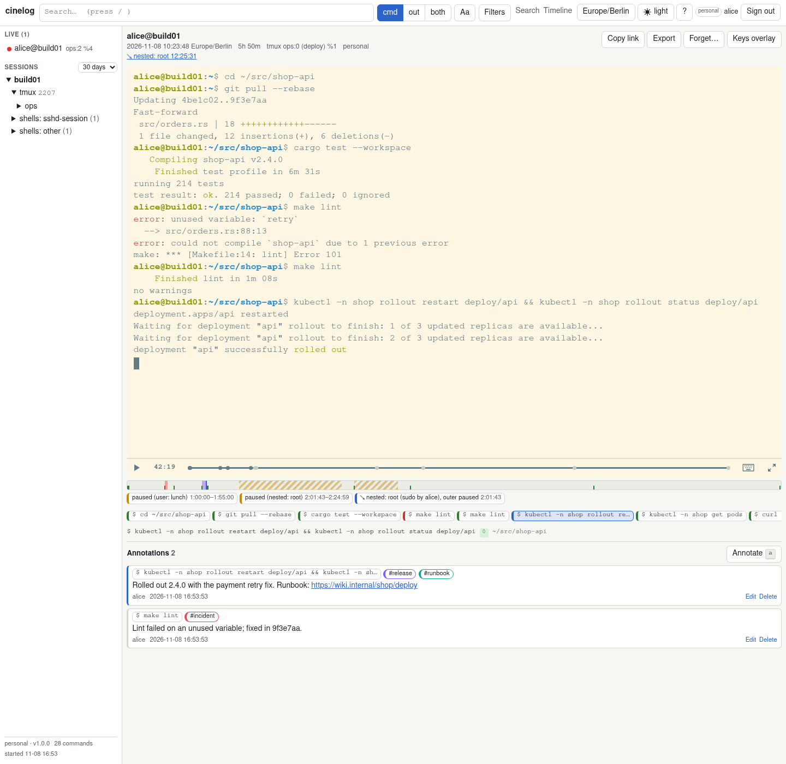](docs/screenshots/session-light.png) | [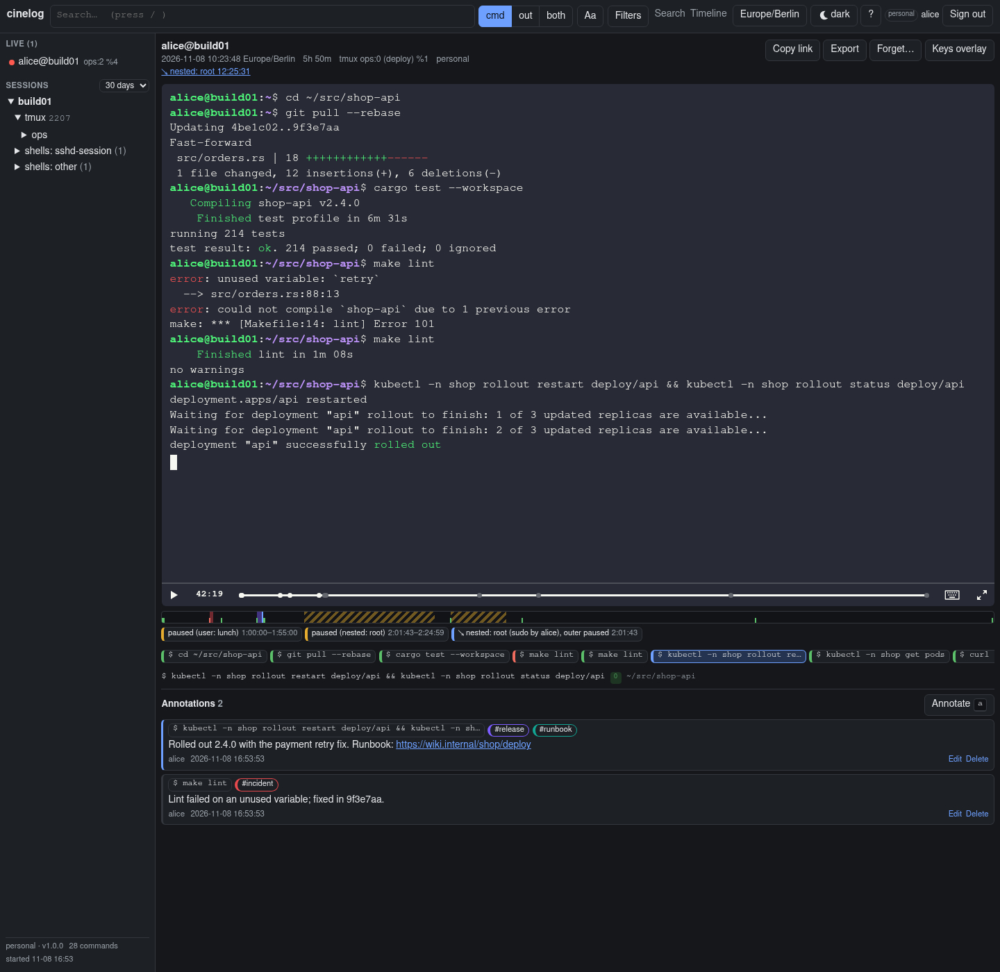](docs/screenshots/session-dark.png) |
| Timeline: one row per pane or shell, coloured by exit status, pauses hatched, idle time collapsed | [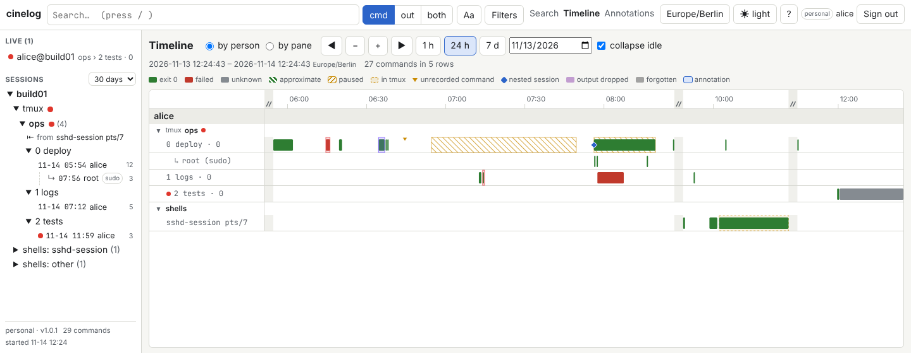](docs/screenshots/timeline-light.png) | [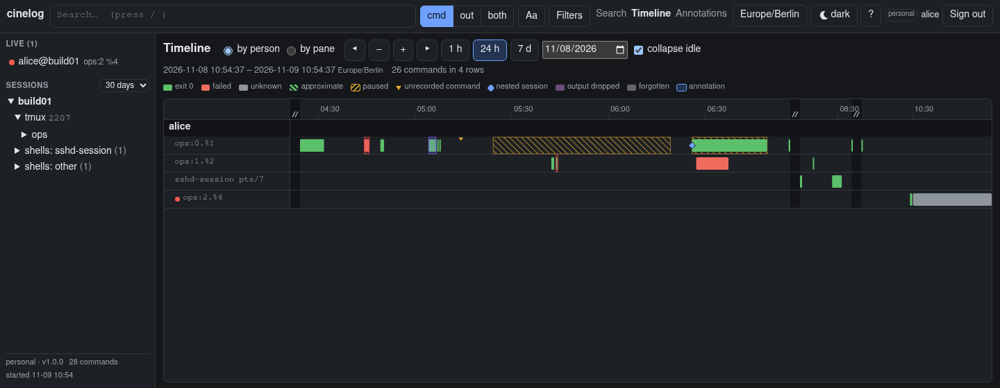](docs/screenshots/timeline-dark.png) |
| Live: a running shell, read-only; a late joiner sees the current screen | [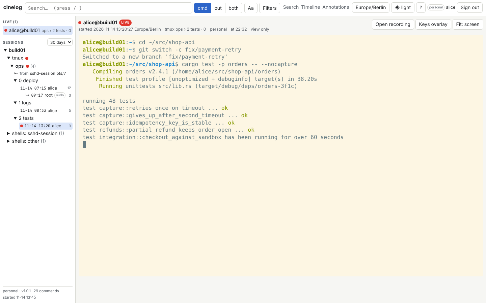](docs/screenshots/live-light.png) | [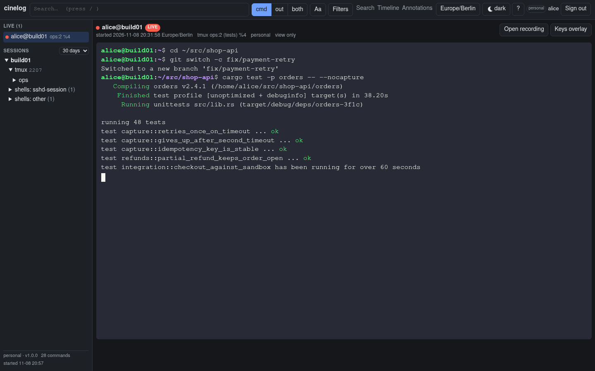](docs/screenshots/live-dark.png) |
| Keyboard: everything works without a mouse (`?`) | [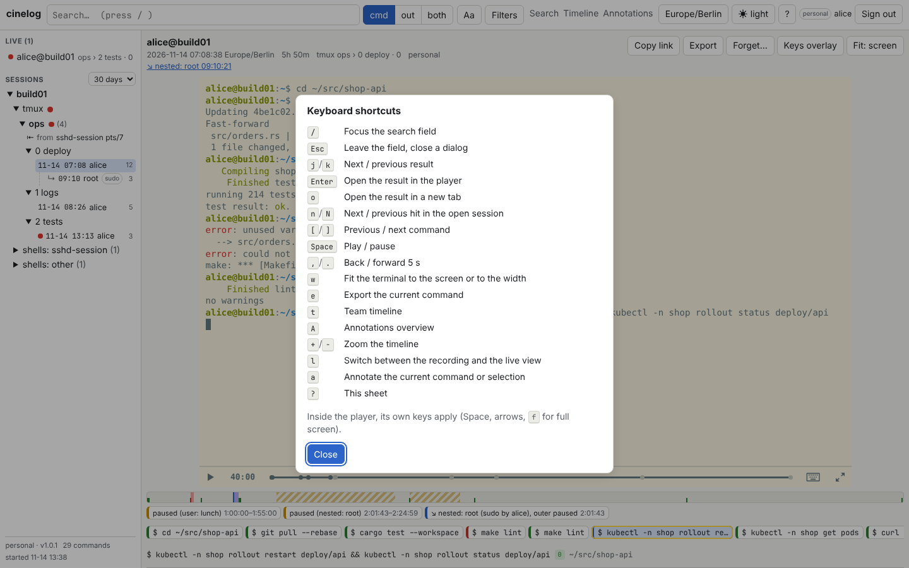](docs/screenshots/shortcuts-light.png) | [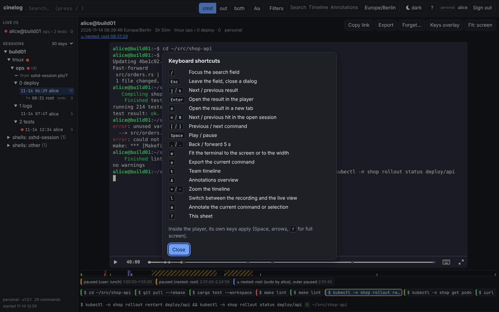](docs/screenshots/shortcuts-dark.png) |
| Login: token once, then an HttpOnly session cookie; the certificate fingerprint to compare | [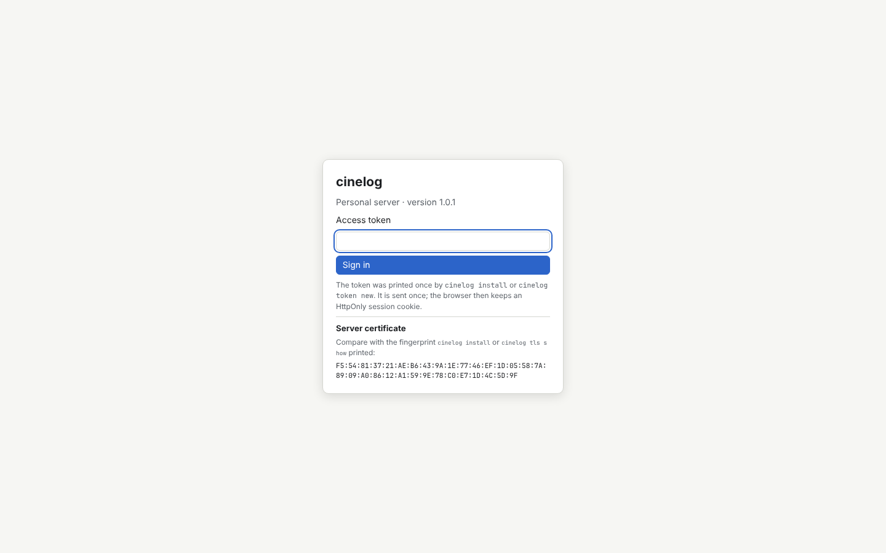](docs/screenshots/login-light.png) | [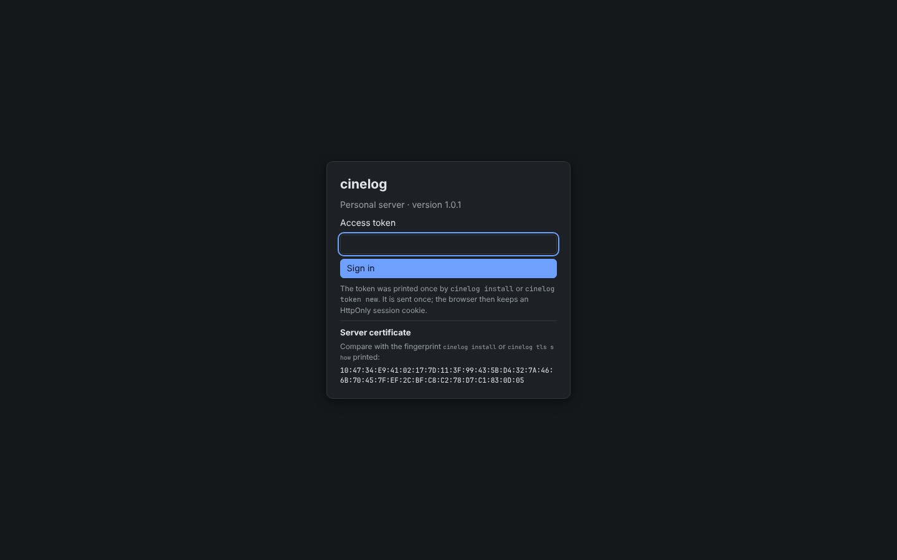](docs/screenshots/login-dark.png) |

The screenshots show a synthetic demo data set. `pnpm -C web docs:shots` regenerates them
([web/e2e/docs/](web/e2e/docs/README.md)).

**Keys:**

| Key | Action |
|---|---|
| `/` | Search |
| `j` / `k`, `Enter`, `o` | Move through results, open one, open it in a new tab |
| `n` / `N` | Next or previous hit in the open session |
| `[` / `]` | Previous or next command |
| `Space`, `,` / `.` | Play or pause; step back or forward 5 s |
| `t` | Timeline |
| `l` | Switch between the recording and the live view |
| `a` | Annotate |
| `e` | Export |
| `?` | All shortcuts |

The theme follows the system. The header toggle switches between auto, light and dark. Times
are shown in your local zone, and a UTC toggle switches them.

**The certificate** is self-signed and valid for 825 days. It is regenerated when the host
name or the stable addresses change, or when it is about to expire. `doctor` and the login
page then show the new fingerprint. It covers:

- the host names and `server.hostnames`;
- the *stable* local addresses.

Temporary IPv6 addresses and the addresses of virtual interfaces (docker, bridges,
WireGuard, VPNs …) are left out, so the fingerprint does not change on every restart. The
server still answers on those addresses. To put one into the certificate, list it in
`server.hostnames`. To use your own certificate, set `server.tls_cert` and `server.tls_key`.

**Sessions** are bound to the browser's address and User-Agent. They expire after 12 h idle
or 7 days, whichever comes first. The API is documented in [docs/API.md](docs/API.md).

## Configuration

`~/.config/cinelog/config.toml` is personal; `/etc/cinelog/team.toml` is for the team.
Every key is optional. `cinelog install` writes a commented template with all defaults.
The most useful keys:

| Key | Default | |
|---|---|---|
| `paths.logs` | `~/logs` | Where casts go. Team: set only in `/etc/cinelog/team.toml` (default `/root/logs`), never taken from `$HOME`; `install --team` adapts the unit's `BindPaths` |
| `record.input` | `true` | Record keystrokes (subject to the password rules above) |
| `record.input_suppress` | `["password-prompt", "prompt-heuristic", "paused", "terminal-responses"]` | Add `"relay"` to drop all keystrokes while sudo, ssh and the like run in the foreground |
| `record.nested` | `"pause"` | What your recording does while a nested `sudo` recording runs: `pause`, `record` (copies root content into your personal cast) or `ignore` |
| `record.mirror_cmdline` | `true` | Show the foreground command in the recorder's command line (tmux automatic-rename) |
| `record.rotate_mb`, `record.rotate_days` | `512`, `7` | Continue long sessions in a new part. The UI shows one session |
| `shell.motd`, `shell.banners`, `shell.title`, `shell.title_link` | `true`, `true`, `true`, `false` | Prompt-side extras; `title_link` puts the session URL into the window title |
| `server.autostart` | `"auto"` | `auto` (systemd unit, else started by the recorder), `systemd`, `shell` or `off` |
| `server.bind` | `["0.0.0.0:auto", "[::]:auto"]` | `auto` is 10000 (team) or 10000 + uid (personal); the chosen port is kept |
| `server.hostnames` | `[]` | Extra names for the certificate and the Host check |
| `index.output`, `index.gap_output` | `true`, `true` | Index command output, and output outside commands |
| `index.redact` | `[]` | Optional regexes masked at index time. Off by default; nothing is redacted |
| `retention.compress_after_days` | `14` | zstd compression of finished casts |

A broken config makes new shells start unrecorded, with one warning, until it is fixed.
`cinelog doctor` shows the error.

## Upgrading and uninstalling

- **Personal:** `zimfw update`. The new binary is verified and swapped in by rename.
  Running recorders keep their old executable until their shell exits.
- **Team:** `sudo ~/.zim/modules/cinelog/bin/cinelog install --team --upgrade`. This copies
  the verified binary, refreshes the plugin copy and restarts the team server.
- **Version skew** between the plugin, your binary, the team binary and the servers is
  allowed within 1.x. The MOTD and `cinelog doctor` report it and print the exact upgrade
  command ([docs/STABILITY.md](docs/STABILITY.md)).
- **Uninstall:** `cinelog install --uninstall` (and `sudo … install --team --uninstall`)
  removes the units, symlinks and the system zshrc block. Then remove the `zmodule` line.
  Casts and databases stay where they are.

Coming from the old Python/asciinema plugin, or from a 0.x pre-release: see
[docs/MIGRATING.md](docs/MIGRATING.md).

## Building from source

```zsh
pnpm -C web install --frozen-lockfile && pnpm -C web build   # the web UI (optional)
cargo build --release --locked                                # target/release/cinelog
```

- The binary embeds `web/dist` when it exists. Without it, the binary serves a short page
  that explains how to build the UI; the API still works.
- `CINELOG_WEB_DIST=<dir>` embeds another build. It is read at **build time**, and a relative
  path is taken from the repository root (not from the current directory).
- Tests: `cargo test --workspace`; `pnpm check`, `pnpm lint` and `pnpm test` in `web/`;
  `pnpm -C web e2e` against a mock server; `CINELOG_E2E_BIN=../target/debug/cinelog pnpm
  -C web e2e:real` against a real server (the path is relative to `web/`).
- The integration tests in `tests/it` drive real zsh and tmux instances, each on a private
  tmux socket. The tests that need root are listed in
  [docs/MANUAL-TESTS.md](docs/MANUAL-TESTS.md).

## Behaviour notes

- **tmux and terminal integration.** The recorder takes the place of the shell process.
  - It follows the shell's working directory, so `#{pane_current_path}` and "open a new tab
    here" keep working.
  - It mirrors the foreground command into its own command line, so tmux automatic-rename
    shows `vim` or `sleep` rather than `cinelog`. `ps -o comm` still shows `cinelog`.
- **Login shells.** The outer shell execs into the recorder while it reads `.zshrc`. The
  recorded inner shell is not a login shell, so **`.zlogin` does not run**. Move its
  content to `.zshrc`. Exported variables can also go to `.zprofile`, which the outer login
  shell reads before the exec.
- **powerlevel10k instant prompt** above the module works. Sourcing `shell/early.zsh` at the
  top of `.zshrc` is still the recommended setup.
- **Failure never blocks a shell.** If recording cannot start (a full or unwritable log
  directory, a broken config, a missing binary), the shell starts unrecorded. It prints one
  `cinelog: not recording` warning and writes the reason to
  `~/.local/state/cinelog/rec.log`.
- **Forgetting is not erasing.** `forget` removes rows from the index and masks playback and
  export. It never rewrites a cast: root and the cast's owner can still read the file.
  There is no automatic secret redaction ([SECURITY.md](docs/SECURITY.md#3-forget)).
- **`hist` and `here` are gone.** Use `cinelog search` and `cinelog search --cwd .`. The old
  per-folder history in `~/.zsh_history.d/` is left alone.

## Documentation

| Document | |
|---|---|
| [docs/MIGRATING.md](docs/MIGRATING.md) | From the old plugin, or from 0.10–0.13, to 1.0; rollback |
| [docs/SECURITY.md](docs/SECURITY.md) | Threat model, what is recorded, who can read it, the web server's defences, residual risks |
| [docs/STABILITY.md](docs/STABILITY.md) | What stays stable across 1.x, and the version-skew policy |
| [docs/PROTOCOL.md](docs/PROTOCOL.md) | The marker protocol, the cast format and the shell ⇄ binary interface |
| [docs/API.md](docs/API.md) | The web API (v1) |
| [docs/MANUAL-TESTS.md](docs/MANUAL-TESTS.md) | The manual test matrix for a release |

## License and credits

GPL-3.0-or-later. Thanks to Marcin [ku1ik](https://github.com/ku1ik) for the
[asciinema suite](https://github.com/asciinema/), whose cast format and player cinelog
builds on.
